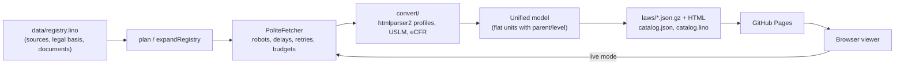

# Issue 1 Case Study: Initial Version of a Static Laws Browser

Issue: <https://github.com/link-assistant/law/issues/1> · Pull request:
<https://github.com/link-assistant/law/pull/2>

## Summary

The repository now holds a static copy of the laws the project knows how to
download for every jurisdiction that
[link-assistant/legal](https://github.com/link-assistant/legal) supports (US,
EU, CN, IN, RU, GE). For each source, the registry records the legal reason
that decides whether we may republish it. One isomorphic converter turns every
source format into a single unified law model. The same code runs in CI/CD,
from the `law` CLI on a laptop, and in the browser at GitHub Pages. A
scheduled workflow re-downloads the sources every day, and it republishes
only when the bytes change. All metadata (registry, legal basis, build
catalog) is stored as Links Notation.

## Data Collected

Raw evidence is in [`data/`](data/):

| File                                                | What it shows                                                                                                             |
| --------------------------------------------------- | ------------------------------------------------------------------------------------------------------------------------- |
| `issue-1.json`, `pr-2.json`                         | Issue body and prepared PR metadata (no comments or reviews existed).                                                     |
| `legal-assistant.snapshot.md`                       | `link-assistant/legal` README with the best practices we follow (fetching rules, robots, jurisdictions).                  |
| `associative-tech-stack.snapshot.md`                | `formal-ai/docs/associative-tech-stack.md`, the stack the issue asks us to use.                                           |
| `source-probe.md`                                   | `law probe` output for every registry target: HTTP status, robots.txt verdict, CORS header, content type, latency.        |
| `robots-probe.txt`                                  | Raw robots.txt answers (status, content type, first lines) for every host.                                                |
| `build-sample.txt`                                  | An early full build: 30 ok, 2 blocked, 7 errors (all RU 403s and one eCFR folder); both causes are now fixed (see below). |
| `kremlin-throttling.txt`                            | Timeline of kremlin.ru dropping connections after a burst, then recovering.                                               |
| `govinfo-stall.txt`                                 | Intermittent 21 s govinfo bulk-data stalls that a retry fixes.                                                            |
| `uscode-size.txt`                                   | Sizes of all 54 U.S. Code titles (178.9 MB XML, 40.8 MB gzip).                                                            |
| `ecfr-sizes.txt`                                    | Sizes of all 50 eCFR titles from the versioner API (829.9 MB).                                                            |
| `build-ru.txt`                                      | Build of the 7 RU codes from kremlin.ru: all ok, 4 015 units, 25.6 MB HTML, 119 min 47 s.                                 |
| `build-without-ru.txt`                              | Build of every non-RU law (`--limit 2` per collection): 135 ok, 2 blocked, 0 errors, 85 MB HTML, 9 min 22 s.              |
| `eu-languages-before.txt`, `eu-languages-after.txt` | Unit counts per EU act in all 24 languages before and after the multilingual converter fix.                               |

The committed [`data/catalog.lino`](../../../data/catalog.lino) merges the
catalogs of these two builds (`experiments/merge-catalogs.mjs`): 142 ok and 2
blocked. The U.S. Code and the eCFR list only their first two titles until
the first full build on `main` rewrites the catalog.

Experiments that produced the data are in [`experiments/`](../../../experiments/).
The runnable offline example is
[`examples/law-convert.mjs`](../../../examples/law-convert.mjs).

## Requirements

Each requirement in the issue text, with where it is implemented and how it
is checked:

| #   | Requirement (issue text)                                                   | Implementation                                                                                                                                                        | Verification                                                                                                                                                                            |
| --- | -------------------------------------------------------------------------- | --------------------------------------------------------------------------------------------------------------------------------------------------------------------- | --------------------------------------------------------------------------------------------------------------------------------------------------------------------------------------- |
| R1  | Follow the best practices of `link-assistant/legal`.                       | Same jurisdictions, polite fetching rules, robots on every redirect, fail-closed robots, crawl-delay cap, byte budgets ([alignment table](#best-practice-alignment)). | `tests/law-pipeline.test.js` "PoliteFetcher safeguards".                                                                                                                                |
| R2  | Provide a copy of all laws we know how to download.                        | `data/registry.lino` lists 19 documents and 2 collections (US Code, eCFR); `law build` downloads and publishes every mirrorable one.                                  | `law build` runs in `laws.yml`; `--min-ok` fails the build if too few laws succeed.                                                                                                     |
| R3  | Present them for reading and referencing.                                  | Static HTML per law with a stable anchor for every unit (`<page>#article-5`), a table of contents, the catalog page and a viewer (`src/web/`).                        | `tests/law-site.test.js` (renderer, sharding); screenshots in the PR.                                                                                                                   |
| R4  | A legal agent can use the copy to reference.                               | Machine-readable `laws/<key>.json.gz` (unified model), `catalog.json` and `catalog.lino`; every unit id is a stable anchor.                                           | `tests/law-site.test.js` "escapes markup and anchors every unit".                                                                                                                       |
| R5  | Make sure it is legal to copy and redistribute.                            | `legal` block per source (status, mirror, basis, basisUrl, attribution), researched below.                                                                            | `law validate` refuses a source without `status`, `basis` and `mirror`; registry tests "records a legal basis for every source" and "mirrors only sources whose legal basis allows it". |
| R6  | Link to original sources.                                                  | Every document carries `sourceUrl`; the header of each page and each catalog row link to it, with the attribution text.                                               | Catalog rows always carry an `original` link (`src/law/site.js`).                                                                                                                       |
| R7  | If copying is not allowed, load dynamically on the client from the source. | `mirror not-allowed` sources render as **live**: the viewer downloads the original in the browser and converts it.                                                    | `tests/law-site.test.js` "mirrors allowed laws, goes live for the rest and reuses previous copies".                                                                                     |
| R8  | Live data is converted to the unified format.                              | The viewer imports `src/law/pipeline.js` and `src/law/convert/`, the same modules used by CI.                                                                         | Bundle built by `law build`; converter tests run on Node, Bun and Deno.                                                                                                                 |
| R9  | Have both options in any case.                                             | Every catalog row that is not blocked links to the viewer; for a mirrored law the viewer offers "load live from the original" (`view.html?doc=…&live=1`).             | Screenshot of the live viewer in the PR.                                                                                                                                                |
| R10 | One conversion algorithm for CI/CD, local and the browser.                 | `src/law/` uses only web APIs (fetch, DecompressionStream, Web Crypto) and pure-JS libraries (htmlparser2, fflate).                                                   | `npm test`, `bun test` and `deno test` in CI; the browser bundle.                                                                                                                       |
| R11 | Cover every country planned in `link-assistant/legal`.                     | US, EU, CN, IN, RU, GE (`JURISDICTIONS` in `src/law/registry.js`).                                                                                                    | Registry test "covers every requested jurisdiction".                                                                                                                                    |
| R12 | Publish a static web copy on GitHub Pages.                                 | `laws.yml` → `pages-deploy` job (`actions/deploy-pages`).                                                                                                             | `tests/laws-workflow.test.js` "deploys Pages and commits the catalog only from main".                                                                                                   |
| R13 | This repository is the source of all metadata, as Links Notation.          | `data/registry.lino` (input) and `data/catalog.lino` (build result, committed by CI), parsed with `links-notation`.                                                   | "Links Notation helpers" round-trip tests and "is valid".                                                                                                                               |
| R14 | Use the associative tech stack where possible.                             | `links-notation`, `lino-objects-codec` ([analysis](#associative-tech-stack)).                                                                                         | Dependencies in `package.json`.                                                                                                                                                         |
| R15 | Scheduled CI/CD auto-updates laws when new versions arrive.                | Daily cron `23 4 * * *`; sha256 per source; unchanged laws keep their `updated` date; failed downloads reuse the published copy.                                      | Workflow test "refreshes the laws on a schedule…"; site test "keeps the update time while the source hash is unchanged".                                                                |
| R16 | Collect issue data into `docs/case-studies/issue-1`.                       | This folder and `data/`.                                                                                                                                              | —                                                                                                                                                                                       |
| R17 | Deep case study with online research.                                      | This document (legal research, standards, libraries, measurements).                                                                                                   | —                                                                                                                                                                                       |
| R18 | List every requirement and propose solutions and plans.                    | This table and [Solution plans](#solution-plans-per-requirement).                                                                                                     | —                                                                                                                                                                                       |
| R19 | Check known existing components and libraries.                             | [Existing components](#existing-components-and-standards).                                                                                                            | —                                                                                                                                                                                       |
| R20 | Plan and execute everything in this one pull request.                      | PR 2.                                                                                                                                                                 | —                                                                                                                                                                                       |

## Architecture



- **Unified model** (`src/law/model.js`): a document is an ordered flat list
  of units (`id`, `kind`, `num`, `heading`, `text`, `parent`, `level`) plus
  metadata (`jurisdiction`, `language`, `sourceUrl`, `version`,
  `retrievedAt`, `sha256`). Unit ids are unique and double as HTML anchors.
  The flat parent/level list is the same shape as a links network
  (`unit → parent`), and it keeps diffs small.
- **Converters** (`src/law/convert/`): USLM XML for the U.S. Code, eCFR XML,
  and declarative htmlparser2 profiles (`us-constitution`, `eu-oj`,
  `eu-oj-issue`, `zh`, `ru`, `ge`, `in`) that map headings such as
  `Article 5`, `Статья 5`, `第五条`, `მუხლი 5` to units.
- **Modes** per document: `mirror` (copy published), `live` (only the viewer
  converts it on demand), `blocked` (the catalog explains why and links to
  the source), `reused` (a refresh failed; the previous published copy is
  kept).

## Legal Analysis per Jurisdiction

| Jurisdiction | Source                                           | Legal basis                                                                                                                                                                                                                                                                                                                                                                                                                  | Decision                                                                             |
| ------------ | ------------------------------------------------ | ---------------------------------------------------------------------------------------------------------------------------------------------------------------------------------------------------------------------------------------------------------------------------------------------------------------------------------------------------------------------------------------------------------------------------- | ------------------------------------------------------------------------------------ |
| US           | archives.gov, uscode.house.gov, govinfo/ecfr.gov | [17 U.S.C. § 105](https://www.copyright.gov/title17/92chap1.html#105): U.S. Government works are not protected by copyright; the Constitution also predates copyright.                                                                                                                                                                                                                                                       | Mirror.                                                                              |
| EU           | Publications Office (Cellar / EUR-Lex)           | [Commission Decision 2011/833/EU](https://eur-lex.europa.eu/eli/dec/2011/833/oj) (in force) allows reuse with acknowledgement of the source; the [EUR-Lex legal notice](https://eur-lex.europa.eu/content/legal-notice/legal-notice.html) applies CC BY 4.0 and asks for credit and for changes to be indicated. Only the printed Official Journal is authentic.                                                             | Mirror with attribution; pages say the text is converted.                            |
| CN           | www.gov.cn                                       | Copyright Law of the PRC, Article 5(1) ([WIPO Lex](https://www.wipo.int/wipolex/en/legislation/details/6062)): laws, regulations and their official translations are not protected.                                                                                                                                                                                                                                          | Mirror (constitution).                                                               |
| CN           | flk.npc.gov.cn                                   | Texts are free of copyright, but `robots.txt` answers `User-agent: * / Disallow: /`.                                                                                                                                                                                                                                                                                                                                         | **Blocked**: not crawled; the catalog links to it.                                   |
| RU           | kremlin.ru                                       | Civil Code Article 1259(6): official documents are not objects of copyright (see also the [Wikisource PD-RU-exempt note](https://ru.wikisource.org/wiki/Шаблон:PD-RU-exempt)); [kremlin.ru copyright page](http://www.kremlin.ru/about/copyrights) licenses its materials under CC BY 4.0.                                                                                                                                   | Mirror with `crawlDelay 6`.                                                          |
| GE           | matsne.gov.ge                                    | Law of Georgia on Copyright and Related Rights, Article 8: official documents and their official translations are not protected ([matsne 16198](https://matsne.gov.ge/en/document/view/16198)).                                                                                                                                                                                                                              | Mirror; only the Georgian text is official.                                          |
| IN           | indiacode.nic.in, legislative.gov.in             | Copyright Act 1957, s. 52(1)(q)(ii): an Act of a Legislature may be reproduced only **together with commentary** or other original matter ([Copyright Act on India Code](https://www.indiacode.nic.in/handle/123456789/1367), [SpicyIP discussion](https://spicyip.com/2017/12/does-the-copyright-act-stand-in-the-way-of-access-to-legislations-pil-claims-bare-acts-by-private-publishers-infringe-govts-copyright.html)). | Not mirrored (`mirror not-allowed`) → a live candidate, but **blocked** (see below). |

The registry stores this as data, so a change in law or terms is a one-line
edit that `law validate` checks:

```lino
eu-cellar:
  legal:
    status reuse-with-attribution
    mirror allowed
    basis 'Commission Decision 2011/833/EU on the reuse of Commission documents …'
    basisUrl 'https://eur-lex.europa.eu/eli/dec/2011/833/oj'
    attribution '© European Union, https://eur-lex.europa.eu. Only the Official Journal of the European Union is authentic.'
```

This is research and not legal advice. The basis links let a reviewer check
every decision.

## Source Probe Findings

`law probe` (see `data/source-probe.md` and `data/robots-probe.txt`) checks
every target with the identified User-Agent `link-assistant-law/…` and the
robots token `link-assistant-law`.

- **Allowed, text/plain robots.txt:** archives.gov, uscode.house.gov,
  govinfo.gov, ecfr.gov, gov.cn, kremlin.ru, matsne.gov.ge, pravo.gov.ru.
- **flk.npc.gov.cn:** disallows every agent, so `cn/civil-code` is blocked.
- **publications.europa.eu:** answers robots.txt with 429 to everyone. RFC
  9309 §2.3.1.3 treats a 4xx as "no rules", so it is allowed. Google instead
  treats 429 like a 5xx; we follow the RFC and keep the 1.5 s spacing.
- **eur-lex.europa.eu:** answers robots.txt with `202 text/html` and an empty
  body (a bot challenge). We never download from it; it is only the
  human-readable link target. An HTML page in place of robots.txt is now read
  as a full disallow (commit 2a9c263), following the legal repository's
  "HTML responses in place of robots.txt fail closed" rule.
- **India:** `legislative.gov.in` and `indiacode.nic.in` answer 403 (and
  sometimes 500/302) to the identified User-Agent. They serve 200 to browser
  User-Agents, but we do not spoof. They send no CORS headers, and the texts
  are PDFs.
- **CORS:** only gov.cn (`*`), archives.gov (origin echo), matsne
  (`*.matsne.gov.ge`, which is useless for other origins) and the eCFR API
  answer with CORS headers. For the other sources, live mode in the browser
  needs a user-configured CORS proxy (Settings in the viewer). The registry
  stores this as `cors` / `liveCors`.

## Measurements

- **Throttling (kremlin.ru)** — `data/kremlin-throttling.txt`: six pages at
  about 6.1 s intervals, then the host dropped connections
  (`UND_ERR_SOCKET`, `UND_ERR_CONNECT_TIMEOUT`) for about a minute, then
  recovered. An earlier full build got 403 for every RU code
  (`data/build-sample.txt`). Fix: `crawlDelay 6` for the source. After a
  failed attempt the fetcher doubles the host's interval (up to 60 s). After
  a 403 or 429 it marks the host refused and does not retry. Result of an
  RU-only build with the fix (`data/build-ru.txt`): all 7 codes ok,
  constitution 156 units, civil code part 1 662, administrative offences code
  1168, criminal procedure code 644, tax code part 1 323, budget code 493 and
  tax code part 2 569, 25.6 MB of HTML, in 119 min 47 s. One socket close was
  retried successfully.
- **Build time** — kremlin.ru serves one page per 6 s, so the RU codes alone
  take about two hours; everything else took 9 min 22 s with two titles per
  collection (`data/build-without-ru.txt`). One after another, the full build
  would come close to the 180-minute job limit. The builder therefore runs
  one lane per source at the same time (each lane in plan order, and the
  fetcher still spaces requests per host), and starts the bulk eCFR
  collection (`priority 6`) after the other lanes, so it cannot use up the
  HTML budget first. The full build then takes about as long as its slowest
  source plus the eCFR.
- **Same result in the browser** — the viewer converted the Chinese
  constitution live from www.gov.cn (the only source that sends CORS
  headers) into 157 units with source SHA-256 `c529b6c7…5ab98`, exactly what
  the Node build stored in its catalog (`docs/screenshots/law-viewer-live.png`).
  For EUR-Lex, which sends no CORS header, the viewer explains that a CORS
  proxy is needed (see Settings) and keeps the mirrored copy.
- **Stalls (govinfo)** — `data/govinfo-stall.txt`: two requests timed out
  after about 21.5 s; a retry succeeded. Fix: retries with backoff, and the
  `--previous` site is reused when a refresh fails.
- **Size budgets** — the full U.S. Code is 178.9 MB of XML (largest title
  42: 33.8 MB), and the eCFR is 829.9 MB. GitHub Pages allows a 1 GB site
  and recommends staying below it. Laws are therefore published as gzip JSON,
  and static HTML is written until `--html-budget` (600 MB by default) is
  reached. Laws past the budget are read through the viewer from their JSON
  copy. The eCFR runs last (`priority 6`). Body reads stop at 512 MiB per
  response (`TOO_LARGE`).
- **EU in 24 languages** — `data/eu-languages-*.txt`. Before the fix, Finnish,
  Croatian, Hungarian, Lithuanian, Latvian and Portuguese lost most units
  (GDPR 27 instead of 126; treaties 134–199 instead of about 958), because
  their headings put the number first (`5. cikk`, `5 straipsnis`) or use
  other words. After the fix, every language gives DMA 62, GDPR 126, AI Act
  156 and DSA 111 units; the treaties give 957–959. The small spread comes
  from the source itself: some annex headings have no numeral (`ALLEGATO`,
  `ANNESS`, `PRILOGA`), and the Romanian text has the typo `TITLULVII`.

## Best-Practice Alignment

From `link-assistant/legal` (`data/legal-assistant.snapshot.md`):

| Practice in legal                                         | Here                                                                                                                                                                                                        |
| --------------------------------------------------------- | ----------------------------------------------------------------------------------------------------------------------------------------------------------------------------------------------------------- |
| Same jurisdictions (US, EU, CN, IN, RU, GE)               | `JURISDICTIONS` in `src/law/registry.js`.                                                                                                                                                                   |
| Robots rules on every redirect target                     | Manual redirects; each hop is checked (`MAX_REDIRECTS` 5).                                                                                                                                                  |
| Per-origin spacing ≥ 1.5 s or the stricter Crawl-delay    | `PoliteFetcher` 1500 ms default; registry `crawlDelay`; published `Crawl-delay`.                                                                                                                            |
| A Crawl-delay above the 60 s wait budget stops collection | `CRAWL_DELAY_TOO_LONG`.                                                                                                                                                                                     |
| Finite streaming byte budgets                             | `readLimited`, 512 MiB default (`TOO_LARGE`).                                                                                                                                                               |
| Retry and backoff                                         | Retries with exponential backoff; host slow-down; `HOST_REFUSED` after 403/429.                                                                                                                             |
| HTML in place of robots.txt fails closed                  | Done (2a9c263). 5xx also means disallow-all (RFC 9309).                                                                                                                                                     |
| Transport logs off unless `--debug`                       | Partly: the CLI writes retries, robots decisions and network causes (`UND_ERR_*`) to stderr on every run; there is no `--debug` switch yet, and the library logs nothing unless a `log` callback is passed. |
| Explicit law-body selector for HTML                       | Every HTML document has a `selector`; an empty conversion fails the build for that law, so the previous copy is kept.                                                                                       |
| ZIPs limit uncompressed content                           | U.S. Code ZIPs are read one entry at a time with fflate. There is no separate uncompressed cap yet; the 512 MiB download cap bounds the input.                                                              |
| Conditional ETag / Last-Modified requests                 | Not used: sources are compared by sha256 after download, which also works for hosts without validators. This is a possible improvement to save bandwidth.                                                   |
| No spoofing; blocked work stays blocked                   | India and NPC are recorded as blocked with reasons.                                                                                                                                                         |

## Associative Tech Stack

From `data/associative-tech-stack.snapshot.md`:

| Component                 | Used | Why                                                                                                                                                                                                                                                                                                      |
| ------------------------- | ---- | -------------------------------------------------------------------------------------------------------------------------------------------------------------------------------------------------------------------------------------------------------------------------------------------------------- |
| `links-notation` 0.27     | Yes  | Parses `data/registry.lino` and the catalog.                                                                                                                                                                                                                                                             |
| `lino-objects-codec` 0.9  | Yes  | Encodes structured values in the catalog. While integrating it we found and reported [lino-objects-codec#77](https://github.com/link-foundation/lino-objects-codec/issues/77): `parseIndented` cannot read `formatIndented` output for multiline strings, so multiline text is kept out of codec values. |
| `lino-arguments` 0.4      | No   | The CLI has six flags handled by Node's built-in `parseArgs`, which also runs in Bun and Deno. `lino-arguments` would add yargs plus `.lenv` loading that the build does not need. It is a good fit if the CLI grows configuration files.                                                                |
| `lino-i18n` 0.4           | No   | The site UI is English-only for now (laws keep their own languages). It is the planned way to localise the viewer.                                                                                                                                                                                       |
| `meta-language`           | No   | It models source text as a links CST. Our converters need a forgiving HTML/XML tokenizer for real-world government pages, which htmlparser2 provides.                                                                                                                                                    |
| `link-cli`, `doublets-rs` | No   | Native Rust storage; a static Pages site has no server process.                                                                                                                                                                                                                                          |
| `doublets-web`            | No   | A browser link store; the viewer only reads published JSON, so there is nothing to store.                                                                                                                                                                                                                |

## Existing Components and Standards

- **Akoma Ntoso / OASIS LegalDocML**
  ([v1.0 vocabulary](https://docs.oasis-open.org/legaldocml/akn-core/v1.0/akn-core-v1.0-part1-vocabulary.html)):
  the international XML standard for legislation. USLM, the U.S. Code
  format, is derived from it. Our unit kinds (`part`, `chapter`, `section`,
  `article`, `paragraph`) follow its hierarchy names, so exporting to Akoma
  Ntoso is a later mapping step. A full AKN serializer was out of scope
  because no source here publishes AKN.
- **USLM** ([OLRC downloads](https://uscode.house.gov/download/download.html),
  [GPO schema on GitHub](https://github.com/usgpo/uslm)): read directly by
  `src/law/convert/uslm.js`.
- **eCFR APIs**: versioner `full` XML is used for live mode (it has CORS);
  govinfo bulk data is used for CI.
- **EU tools**: [tulit](https://tulit-docs.readthedocs.io) (Python, Cellar
  XHTML and AKN parsers), [eurlex / eurlxp](https://pypi.org/project/eurlex/)
  (Python EUR-Lex clients), eurlex-toolbox and eur-lex-visualiser (Formex).
  They confirmed the approach: Cellar XHTML by CELEX number, content
  negotiation by language. They are Python or server-side, so they cannot
  run in the browser, and a JS reimplementation was needed for R10.
- **htmlparser2 / domutils / fflate**: small pure-JS parsers that work in
  Node, Bun, Deno and browsers.

## Solution Plans per Requirement

- **Legality (R5, R7):** use a per-source `legal` record with a cited basis
  instead of a global assumption. The alternative, mirroring everything that
  is public, was rejected because India's s. 52(1)(q)(ii) needs commentary.
- **Formats (R8, R10):** two options were weighed — a server-side converter
  per source (as in tulit) versus a single isomorphic JS converter. The
  isomorphic one was chosen because the issue requires the browser path.
- **Freshness (R15):** a daily cron with content hashes and reuse of the
  previous copy. A per-source RSS/ELI feed watcher is a future option for
  sources that publish one (EUR-Lex has ELI).
- **Scale (R2, R12):** gzip JSON for every law plus an HTML budget, to stay
  under the Pages size limit while keeping the whole U.S. Code and eCFR.
- **Metadata (R13, R14):** Links Notation for the registry and the catalog.
  The catalog is committed by CI, so its history shows when each law changed.

## Blocked and Remaining Items

These are reported as blocked, not done:

1. **`cn/civil-code`** (flk.npc.gov.cn): robots.txt disallows all agents.
   Unblocking needs permission from the NPC, or a permitted alternative
   source for the Civil Code.
2. **India (`in/constitution`)**: the publisher answers 403 to an identified
   User-Agent, sends no CORS headers and publishes PDFs; verbatim
   republication also needs commentary under s. 52(1)(q)(ii). It stays
   `blocked` with `mirror not-allowed`. Unblocking needs the publisher to
   allow identified bots (or an official API), plus a PDF text profile
   (`profile in` is ready for HTML).
3. **Human actions for CI** (pull requests do not need them; on `main` the
   affected job fails until they are done, with an explicit `::error::` for
   the missing token):
   - set GitHub Pages "Source" to "GitHub Actions";
   - add the `RELEASE_PR_TOKEN` secret so `catalog-commit` can push
     `data/catalog.lino` to `main`;
   - the template's npm trusted publishing (OIDC) release preflight.
4. **Upstream:** lino-objects-codec#77 (open), worked around as described.
